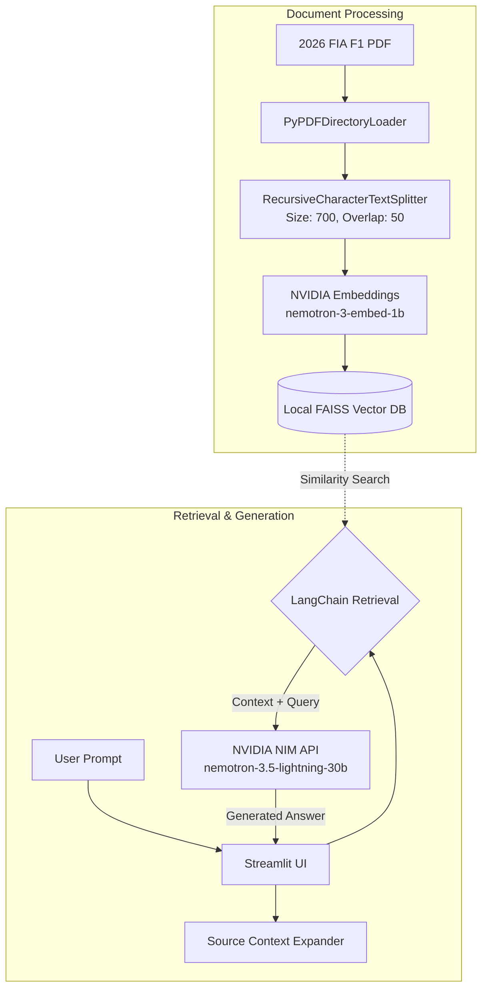

# 🏎️ Formula 1 Technical Regulations RAG Engine


## 📌 Overview
This application is a Retrieval-Augmented Generation (RAG) engine designed to query the complex 2026 FIA Formula 1 Technical Regulations. By leveraging a local FAISS vector store and LangChain orchestration, the system retrieves highly relevant document chunks and passes them to NVIDIA's powerful NIM API to generate accurate, context-aware responses embedded within an interactive Streamlit interface.

## 🏗️ System Architecture & Data Flow



### Data Flow Breakdown
* **Document Loading:** The 2026 FIA Technical Regulations PDF is ingested locally using `PyPDFDirectoryLoader`.
* **Chunking & Embedding:** Text is parsed and divided using `RecursiveCharacterTextSplitter` (700-character chunks, 50-character overlap) before passing through the NVIDIA `nemotron-3-embed-1b` embedding model.
* **Vector Storage:** The generated vector embeddings are indexed in a local, in-memory FAISS database for low-latency similarity searches.
* **LLM Orchestration:** When a user inputs a query, LangChain executes a retrieval chain, fetching the most relevant chunks from FAISS and packaging them alongside the prompt.
* **Generation & UI:** The augmented prompt is sent to the NVIDIA NIM API (`nemotron-3.5-lightning-30b-a3b`), which returns the response to a Streamlit application featuring an interactive expander to display the cited source text.

## 💻 Tech Stack
* **Language:** Python
* **LLM & Embeddings:** NVIDIA NIM API (`nemotron-3.5-lightning-30b-a3b`), NVIDIA Embeddings (`nemotron-3-embed-1b`)
* **Framework:** LangChain
* **Vector Store:** FAISS (Facebook AI Similarity Search)
* **Frontend UI:** Streamlit
* **Document Processing:** PyPDF

## 🚀 Getting Started

### Prerequisites
* Python 3.8+
* An active NVIDIA API Key (for accessing NIM endpoints)

### Installation

1. **Clone the repository:**
   ```bash
   git clone https://github.com/Oshobugie/nimnvida.git
   cd nimnvida
   ```

2. **Set up the environment:**
   Create a `.env` file in the root directory and add your NVIDIA API credential:
   ```ini
   NVIDIA_API_KEY="your_nvidia_api_key_here"
   ```

3. **Install dependencies:**
   ```bash
   pip install -r requirements.txt
   ```

4. **Add the Source Document:**
   Ensure the `2026 FIA F1 PDF` document is placed in the appropriate directory (e.g., `./data/`) as expected by the `PyPDFDirectoryLoader`.

5. **Run the Streamlit application:**
   ```bash
   streamlit run app.py
   ```
   *(Note: replace `app.py` with the actual name of your main python file if it differs)*

## 🔌 Usage
Once the Streamlit server is running (usually at `http://localhost:8501`), open your browser to interact with the UI.
* Type questions regarding the 2026 FIA F1 Technical Regulations into the prompt bar.
* The model will generate a specific answer based on the rules.
* Click the **Context Expander** below the answer to view the exact text chunks and rule numbers the LLM used to formulate its response.

## 👨‍💻 Author
**Osho**  
Machine Learning & AI Automation Engineer  
[LinkedIn](https://www.linkedin.com/in/oshobugie) | [GitHub](https://github.com/Oshobugie)
